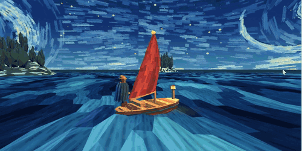

# 星海漫游 · Star Sea Voyage

《星海漫游》是一款受梵高星空启发的 3D 浏览器游戏。项目用 GPT-6.2 Astra 从一张油画风格参考图出发制作。驾驶红帆小船，在由厚涂笔触构成的星海上自由探索。

## 实机试玩

[打开游戏，开始航行](https://gml-blip.github.io/stars/)

## 玩法

- 电脑使用 WASD 或方向键驾驶，按住鼠标拖动视角。
- 手机在左半屏拖动驾驶，在右半屏拖动视角。

## 本地打开

用支持 WebGL 的浏览器打开根目录的 `index.html`，点击「开始航行」。项目为静态 HTML、CSS 和 JavaScript，可直接运行。

## GitHub Pages

在仓库的 Settings → Pages 中选择 Deploy from a branch，发布源使用 `main` 分支的 `/(root)`。启用后的默认地址是 [在线游玩](https://gml-blip.github.io/stars/)。

第三方许可见 [Three.js](THREE-LICENSE.txt) 和 [Patch](PATCH-LICENSE.txt)。
